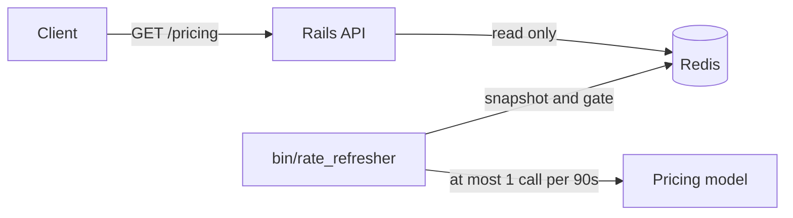

# Dynamic Pricing Proxy

A Rails API that serves hotel room rates from Tripla's dynamic pricing model. The model is expensive to run and limited to 1,000 calls a day, while the API needs to handle at least 10,000 requests a day with rates no older than 5 minutes.

A background worker fetches all the rates and keeps them in Redis. Requests only ever read from Redis, so traffic can't use up the quota, and users never wait on the pricing model.

- [spec.md](spec.md): the original assignment brief
- [DECISIONS.md](DECISIONS.md): the audit log of every decision and change
- [openapi/public_api.yaml](openapi/public_api.yaml): the API reference, generated from the specs

## Setup

Everything runs in Docker. You don't need Ruby installed on your machine.

1. Create your local compose file. It is gitignored, so your token stays out of the repository:

   ```bash
   cp docker-compose.example.yml docker-compose.yml
   ```

2. In `docker-compose.yml`, replace both copies of `REPLACE_WITH_RATE_API_TOKEN` with the token from the [rate-api documentation](https://hub.docker.com/r/tripladev/rate-api). The app won't start without it.

## Run

```bash
docker compose up -d --build

curl 'http://localhost:3000/api/v1/pricing?period=Summer&hotel=FloatingPointResort&room=SingletonRoom'
# {"rate":56700}
```

Requests return `503` until the worker's first successful fetch. That usually takes a few seconds, or up to 90s if the first attempt fails, so try again if you see one.

To see the worker's activity:

```bash
docker compose logs -f rate-refresher
```

## Test

```bash
# Full suite
docker compose exec -e RAILS_ENV=test interview-dev bundle exec rspec

# One file
docker compose exec -e RAILS_ENV=test interview-dev bundle exec rspec spec/services/pricing/rate_refresher_spec.rb

# Lint
docker compose exec interview-dev bundle exec rubocop
```

`RAILS_ENV=test` is needed because the Dockerfile sets it to `development`.

To regenerate the API reference after changing the API (CI fails if it's out of date):

```bash
docker compose exec interview-dev bin/rails openapi_ruby:generate
```

CI builds `docker-compose.yml` from the example file, so the repository needs a `RATE_API_TOKEN` Actions secret.

## API

`GET /api/v1/pricing?period=&hotel=&room=`

| Parameter | Values |
|---|---|
| `period` | `Summer`, `Autumn`, `Winter`, `Spring` |
| `hotel` | `FloatingPointResort`, `GitawayHotel`, `RecursionRetreat` |
| `room` | `SingletonRoom`, `BooleanTwin`, `RestfulKing` |

A successful response returns `200` with the room's current rate:

```json
{ "rate": 56700 }
```

Errors share one format:

```json
{
  "error": {
    "code": "validation_failed",
    "message": "One or more parameters are invalid.",
    "details": [{ "field": "room", "message": "is required" }]
  }
}
```

| Status | Code | Meaning |
|---|---|---|
| `422` | `validation_failed` | A parameter is missing, invalid or not recognized |
| `429` | `rate_limited` | Over 300 requests a minute from one IP. See `Retry-After` |
| `500` | `internal_error` | An unexpected error |
| `502` | `rate_not_available` | No current rate for this room, while others are available |
| `503` | `pricing_unavailable` | No current rates, or Redis is down |

## Design

### The core problem

There are 36 combinations of period, hotel and room, and 288 five-minute windows in a day. Caching each combination separately could need 36 × 288 = 10,368 calls, far over the 1,000 limit. The API accepts batches, so one call can fetch all 36.

Testing the real API changed the design further. **About 1 call in 6 fails**, with 9% returning a `500` and 7.5% hanging, one of them for over 120s. Failed calls still count against the quota. So caching good responses isn't enough: if requests fetch on a miss, an outage turns traffic into calls until the quota runs out.

### How it works



- **When to refresh (180s):** every 5s, `bin/rate_refresher` checks the age of the rates. Once they're 180s old, it fetches all 36 in one call. After a success, the next refresh is 180s later.
- **How often it may call (90s):** a Redis key set atomically allows one call per 90s, successful or not. That caps usage at **960 calls a day, whatever the traffic or failures**. If Redis is down, no call is made.
- **Failures stay invisible:** the two timings work together. If the attempt at 180s fails, the rates are still due, so the worker tries again once the 90s gate clears, at 270s. The current rates stay valid until 300s, so users don't notice.
- **Freshness:** the API gives no timestamps, so each rate's 5 minutes start from just before the call is sent. Rates are never served past that, even during an outage.
- **Bad rows:** the API gives rows no identifiers, so they're matched by their values. A missing or invalid row keeps its earlier rate until that rate's own 5 minutes end, and only that room is affected. Duplicates overwrite, and rows that weren't requested are ignored. All are logged.

### Response times

Moving fetching out of the request path is also a real improvement for users. A cache hit or miss takes about 11ms at p50 on a local development stack, and a miss fails fast with a `503` rather than waiting. A request that fetched its own rates could wait up to 3s on a hung call.

### Approaches considered

| Approach | Worst-case calls/day | Result |
|---|---|---|
| Cache each combination separately | About 10,000 | Exceeds the quota |
| Batch on a cache miss | Grows with traffic during an outage | Quota can run out, and users wait on the model and see its failures |
| Batch on a miss, behind a gate and lock | 960 | Quota is safe, but users still wait, and each double failure blocks rates for 3 minutes |
| **Worker refreshes, requests only read** | **960** | **Chosen:** quota is safe, responses are fast, and most failures are invisible |

### Key decisions

| Decision | Why |
|---|---|
| Fetch all 36 rates in one call | One call per refresh, instead of up to 36 |
| Fetch in a worker, never during a request | Traffic can't spend the quota, and requests don't wait on the model |
| Allow one call per 90s, enforced in Redis | Caps usage at 960 calls a day, even if every call fails |
| Refresh at 180s, with no quick retry | Leaves time for a second attempt before rates expire, while a quick retry would need a longer gate |
| Use Redis through `Rails.cache`, and return `503` if it's down | The quota is per token, so state must be shared. An outage can't be mistaken for a cache miss |
| Give each rate its own timestamp | A rate kept after a missing row can't pass its own 5 minutes |
| Set 1s connect and 2s read timeouts | Successful calls took 43ms at most, while hung calls never returned |
| Keep the worker as a plain loop | What to do depends on the age of the rates rather than the time of day, so a scheduler adds little |
| Use one error format from a central registry | Clients get stable codes, and every failure has the same shape |
| Validate parameters with a request model | The valid values live in one place, and every bad field is reported at once |
| Generate API docs from the specs | The docs are tested against real responses, and CI catches drift |

### Trade-offs

These estimates use the failure rate from one test run of 970 calls against the simulated API.

- **Higher model cost:** about 520 calls a day even with no traffic, against about 345 if requests fetched on demand.
- **Short gaps:** when the attempts at 180s and 270s both fail, about 12 times a day, requests return `503` for up to 60s.
- **Another process to run:** if the worker stops, requests return `503` within 5 minutes and nothing alerts. Production should alert on `503` rates, or on `rate_refresh_succeeded` logs stopping.
- **Limits of the guarantee:** the 960 cap assumes nothing else uses the token and Redis keeps the gate. A Redis wipe could allow one extra call.

### Assumptions

- The catalogue stays at 36 combinations. The API documents no batch size limit, and only 36 items have been tested. If it outgrew one request, the quota would allow only about two batches per window, so going further would need a higher quota, more tokens, or fetching only the combinations in demand.
- `rate` is returned as an integer. The API documentation shows strings, but it returns integers.
- Returning an error is better than serving a rate past 5 minutes.
- Behind a proxy, Rails must be configured to trust it, or all clients would share one rate limit.
- `origins "*"` in the CORS config should be narrowed before production if browsers will call the API directly.

## AI assistance

This solution was developed with Claude Code, in the VS Code extension. It was used across the whole solution: reading the brief and API documentation, testing the live API, proposing designs, writing code, specs and documentation, and running checks.

The workflow was iterative. The author directed the design and made the key decisions, including moving fetching to a worker, keeping earlier rates for missing rows, and never letting traffic reach the quota. Each change was proposed, tested, and committed only after the author approved it.
